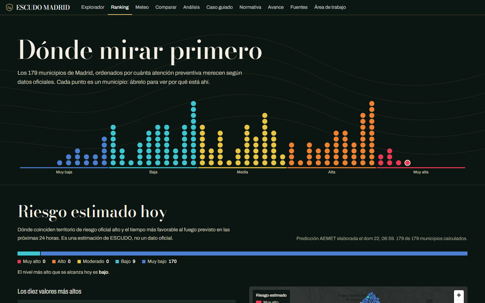
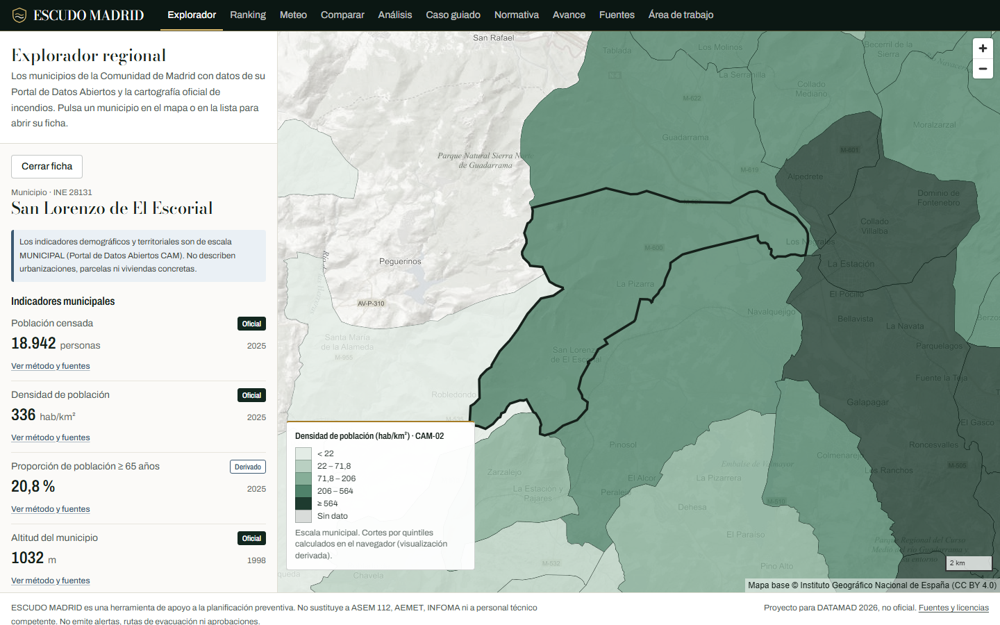
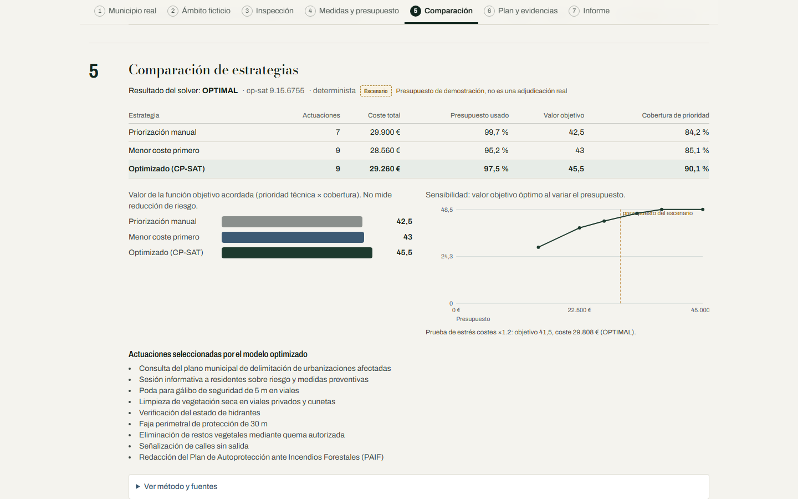

# 13 · ESCUDO MADRID

**Del mapa al plan, y del plan a la ejecución comprobable.** Planificación preventiva de incendios forestales para ayuntamientos, urbanizaciones y técnicos de la Comunidad de Madrid.

| | |
|---|---|
| **Demo pública, abierta y sin registro** | **https://lorenadata-escudo-madrid.hf.space** (empieza por `/ranking`) |
| **Código** (licencia EUPL-1.2) | https://github.com/Lorenadata/escudo-madrid-incendios |
| **Presentación** | [`ESCUDO-MADRID-presentacion.pdf`](ESCUDO-MADRID-presentacion.pdf) |
| **Participante** | Lorena Marcos (participante única) |

> La demo se despierta en unos 40 segundos si nadie la ha abierto en un rato.

## El hallazgo

- **38 municipios** tienen más de la mitad de su término en riesgo alto o muy alto de incendio y están fuera de las Zonas de Alto Riesgo: **no están obligados a tener plan municipal**.
- De los **58 obligados**, solo **28** figuran con su plan aprobado.

Sale de cruzar la cartografía oficial de riesgo (IDEM) con el Plan Anual 2026, Anexos II y VI. No decimos que la lista oficial esté mal: decimos que este cruce merece revisión.

## Qué hace

1. **Ranking** de los 179 municipios por atención preventiva, con el porqué de cada puesto y el riesgo estimado de hoy (cartografía oficial × previsión AEMET; estimación propia, marcada como tal).
2. **Ficha municipal**: cada número con su fuente, fecha y licencia; si un dato no existe, pone «no disponible».
3. **Caso guiado** (urbanización ficticia, marcada así): inspección desde el móvil, actuaciones ligadas al decreto INFOMA y un optimizador que, con 30.000 €, cubre el **90,1 %** de la prioridad técnica frente al **84,2 %** de elegir a mano.
4. **Informe**: plan con responsables, plazos y evidencias. La herramienta prepara el expediente; no lo aprueba. No es una herramienta de emergencias.

| | |
|---|---|
|  |  |
| **Ranking** | **El cruce, en vivo** |
|  |  |
| **Ficha municipal** | **Caso guiado** |

## Datos

**11 conjuntos del Portal de Datos Abiertos de la Comunidad de Madrid** y 18 fuentes en total, cada una con URL, fecha, licencia y huella SHA-256 ([catálogo completo](https://github.com/Lorenadata/escudo-madrid-incendios/blob/main/DATA_CATALOG.md)):

- [Población censada por edad, nacionalidad y sexo. Municipios](https://datos.comunidad.madrid/catalogo/dataset/poblacion_censada_por_edad_nacionalidad_y_sexo)
- [Densidad de población. Municipios](https://datos.comunidad.madrid/catalogo/dataset/1930748)
- [Altitud. Municipios](https://datos.comunidad.madrid/catalogo/dataset/101002)
- [Espacios protegidos](https://datos.comunidad.madrid/catalogo/dataset/espacios_protegidos)
- [Incendios y superficie afectada](https://datos.comunidad.madrid/catalogo/dataset/101019)
- [Repoblaciones forestales](https://datos.comunidad.madrid/catalogo/dataset/repoblaciones_forestales)
- [Distribución de la superficie por usos](https://datos.comunidad.madrid/catalogo/dataset/1101001)
- [Secciones censales](https://datos.comunidad.madrid/catalogo/dataset/secciones_censales)
- [Censo 2021. Viviendas familiares por tipo de vivienda](https://datos.comunidad.madrid/catalogo/dataset/censo_2021_viviendas_familiares_por_tipo)
- [Censo 2021. Viviendas por tipo de edificio](https://datos.comunidad.madrid/catalogo/dataset/censo_2021_porcentaje_viviendas_familiares_por_tipo_edificio)
- [Censo 2021. Viviendas por intensidad de uso según consumo eléctrico](https://datos.comunidad.madrid/catalogo/dataset/censo_2021_viviendas_por_consumo_electrico)

Además: Plan Anual 2026 de prevención de incendios, Decreto INFOMA, cartografía oficial de riesgo (IDEM), AEMET OpenData y EFFIS (Copernicus).

## Cifras comprobables

- **15** puntos del expediente INFOMA, con cita literal del BOCM.
- **18 de 20** preguntas de normativa con la cita correcta, sin IA generativa.
- **196** pruebas automáticas, accesibilidad incluida.
- Se instala con un comando en unos 9 minutos; cada organización solo ve sus datos.
