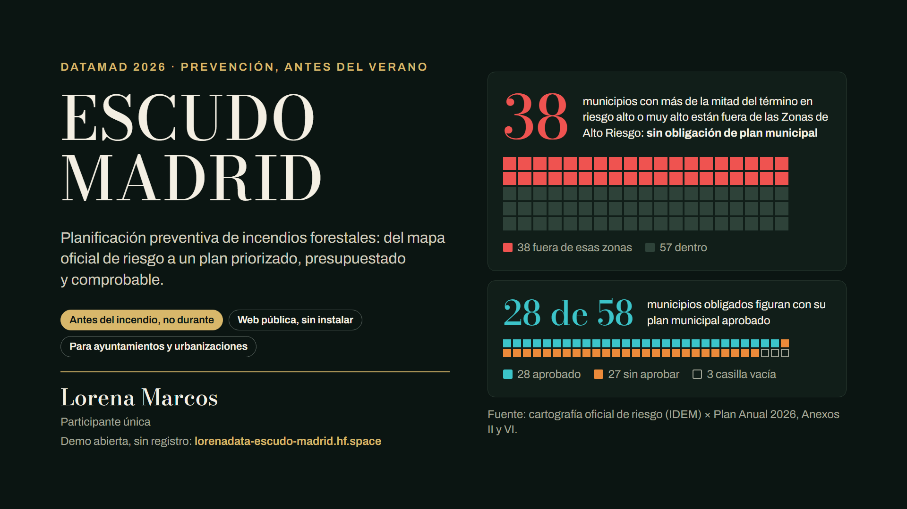
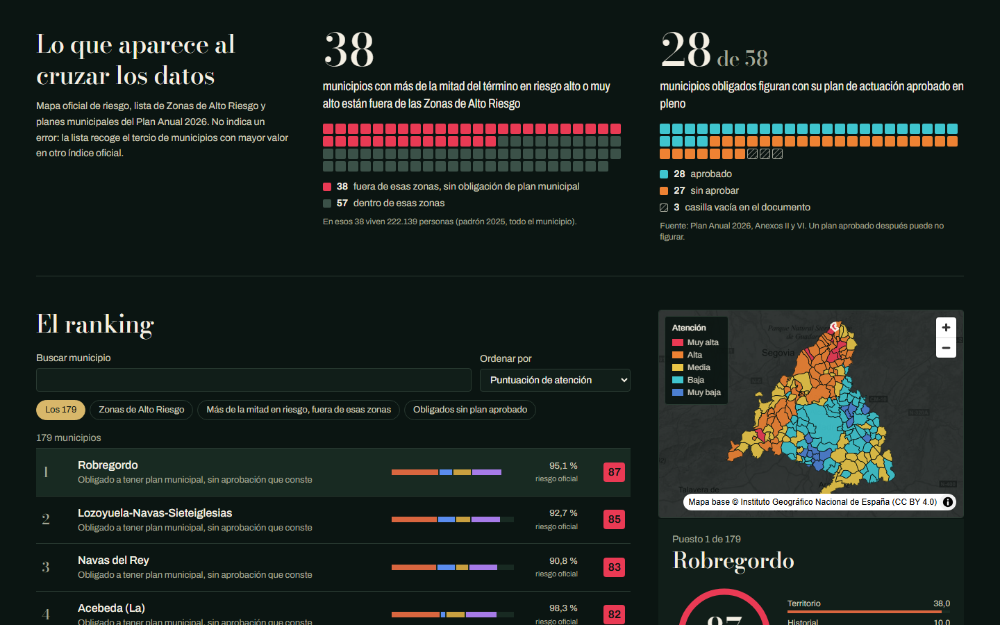

# ESCUDO MADRID · Proyecto 13

**Prevención de incendios forestales, antes del verano.** Del mapa oficial de riesgo a un plan priorizado, presupuestado y comprobable, para ayuntamientos, urbanizaciones y técnicos de la Comunidad de Madrid.

### [▶ Abrir la demo pública](https://lorenadata-escudo-madrid.hf.space/ranking) · [Ver la presentación (PDF)](ESCUDO-MADRID-presentacion.pdf) · [Código fuente](https://github.com/Lorenadata/escudo-madrid-incendios)

La demo es abierta y no pide registro. Si nadie la ha abierto en un rato, tarda unos 40 segundos en despertar.

**Participante:** Lorena Marcos (participante única) · **Licencia:** EUPL-1.2

---

## El hallazgo

| 38 municipios | 28 de 58 |
|:---|:---|
| tienen más de la mitad de su término en riesgo alto o muy alto de incendio y están fuera de las Zonas de Alto Riesgo: **no están obligados a tener plan municipal**. | municipios obligados figuran con su **plan municipal aprobado**. |

*Fuente: cartografía oficial de riesgo (IDEM) cruzada con el Plan Anual 2026, Anexos II y VI. No decimos que la lista oficial esté mal: decimos que este cruce merece revisión.*

## Qué la hace distinta

- **Trabaja antes del incendio, no durante.** Es prevención y planificación para los meses previos al verano: no simula el fuego ni gestiona la emergencia.
- **Parte de un hallazgo comprobable** con datos oficiales: el de arriba.
- **Llega del plan a la obra:** presupuesto, plazos, responsables y pruebas de lo hecho.
- **Es una web pública que ya se puede abrir,** sin instalar nada.

## La web, en cuatro pantallas

| 1 · Ranking de los 179 municipios | 2 · El cruce, en vivo |
|:---:|:---:|
|  |  |
| **3 · Ficha municipal con su fuente** | **4 · Caso guiado** |
|  |  |

1. **Ranking:** los 179 municipios ordenados por atención preventiva, con el porqué de cada puesto y el riesgo estimado de hoy (cartografía oficial × previsión de AEMET; es una estimación propia y está marcada como tal).
2. **El cruce:** el hallazgo en la propia web. Robregordo, el primero, tiene el 95 % de su término en riesgo alto y ningún plan aprobado.
3. **Ficha municipal:** cada número con su fuente, fecha y licencia. Si un dato no existe, pone «no disponible».
4. **Caso guiado** (urbanización ficticia, marcada así): inspección desde el móvil, actuaciones ligadas al decreto INFOMA y un optimizador que, con 30.000 €, cubre el **90,1 %** de la prioridad técnica frente al **84,2 %** de elegir a mano. Termina en un informe que prepara el expediente pero no lo aprueba.

## Resultados comprobables

| Cifra | Qué mide |
|---:|:---|
| **90,1 %** | prioridad técnica cubierta con 30.000 € (frente al 84,2 % manual); caso ficticio, no mide reducción del riesgo |
| **15** | puntos del expediente INFOMA, con cita literal del BOCM |
| **18 de 20** | preguntas de normativa con la cita correcta, sin IA generativa |
| **196** | pruebas automáticas, accesibilidad incluida |

## Datos

**11 conjuntos del Portal de Datos Abiertos de la Comunidad de Madrid** y 18 fuentes en total, cada una con URL, fecha, licencia y huella SHA-256 ([catálogo completo](https://github.com/Lorenadata/escudo-madrid-incendios/blob/main/DATA_CATALOG.md)).

| Conjunto del Portal | Para qué se usa |
|:---|:---|
| [Población censada por edad, nacionalidad y sexo](https://datos.comunidad.madrid/catalogo/dataset/poblacion_censada_por_edad_nacionalidad_y_sexo) | Ficha municipal: población y proporción de 65 años o más |
| [Densidad de población](https://datos.comunidad.madrid/catalogo/dataset/1930748) | Orden, comparador y mapa por densidad |
| [Altitud](https://datos.comunidad.madrid/catalogo/dataset/101002) | Ficha municipal |
| [Espacios protegidos](https://datos.comunidad.madrid/catalogo/dataset/espacios_protegidos) | Catálogo de espacios protegidos |
| [Incendios y superficie afectada](https://datos.comunidad.madrid/catalogo/dataset/101019) | Serie histórica regional de incendios |
| [Repoblaciones forestales](https://datos.comunidad.madrid/catalogo/dataset/repoblaciones_forestales) | Serie regional de contexto |
| [Distribución de la superficie por usos](https://datos.comunidad.madrid/catalogo/dataset/1101001) | Serie regional de usos del suelo |
| [Secciones censales](https://datos.comunidad.madrid/catalogo/dataset/secciones_censales) | Límites municipales del mapa |
| [Censo 2021. Viviendas por tipo de vivienda](https://datos.comunidad.madrid/catalogo/dataset/censo_2021_viviendas_familiares_por_tipo) | Ficha «Vivienda y ocupación» |
| [Censo 2021. Viviendas por tipo de edificio](https://datos.comunidad.madrid/catalogo/dataset/censo_2021_porcentaje_viviendas_familiares_por_tipo_edificio) | Porcentaje de viviendas unifamiliares |
| [Censo 2021. Viviendas por consumo eléctrico](https://datos.comunidad.madrid/catalogo/dataset/censo_2021_viviendas_por_consumo_electrico) | Viviendas vacías o de uso esporádico |

**Otras fuentes oficiales:** Plan Anual 2026 de prevención de incendios, Decreto INFOMA, cartografía oficial de riesgo (IDEM), AEMET OpenData y EFFIS (Copernicus).

## Viabilidad

- Software libre (EUPL-1.2). Se instala con un comando.
- Cada organización ve solo sus datos; accesibilidad WCAG 2.1 AA.
- Si AEMET no responde, la web dice «no disponible»: nunca muestra un dato viejo como actual.
- Es una herramienta de planificación, no de emergencias: no sustituye al 112, a AEMET, a INFOMA ni al personal técnico.
