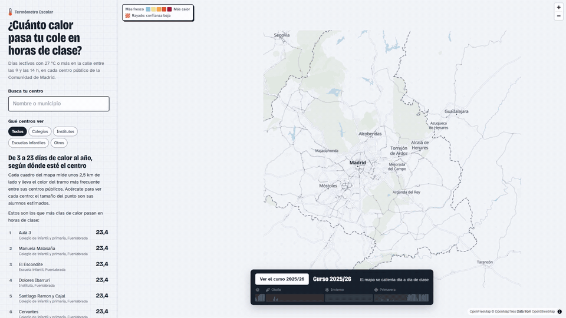

# Termómetro Escolar · proyecto 43

**¿Qué colegio público de Madrid se climatiza primero?** Termómetro Escolar cuenta cuántos días de clase pasa cada centro con calor.

Jorge Asenjo (participación individual).

**[Vídeo de la demo (MP4)](termometro-escolar.mp4)** · **[Mapa en vivo](https://jorge-asenjo.github.io/termometro-escolar/)** · **[Presentación (PDF)](termometro-escolar-datamad-2026.pdf)** · [Código y método](https://github.com/jorge-asenjo/termometro-escolar)

## Por qué

La Comunidad tiene un plan de climatización de 840 M€, que prioriza los institutos y las escuelas infantiles anteriores a 2006. Los ayuntamientos tienen 370 M€ del PIR para sus colegios. Falta un dato para decidir: **cuánto calor pasa cada centro en horas de clase**.

## Qué he hecho

- Con cuatro conjuntos del portal, cuento los días lectivos con 27 °C o más en la calle entre las 9 y las 14 h. Solo uso la temperatura validada (marcada con «V») de las 28 estaciones de la Red de Calidad del Aire.
- Llevo la temperatura de cada estación a cada uno de los 2.078 centros públicos, según la distancia y la altitud.
- Un mapa con buscador y una ficha por centro, que se comparte por WhatsApp.

## Resultado

| | |
|---|---|
| Días de clase con calor al año | Por estación, de **4** en El Atazar a **23** en Fuenlabrada (media de cinco cursos; en 2025/26, de 8 a 35). Por centro, en el mapa, de 3 a 23 |
| Error, validado | **1,5 °C**: quito cada estación y la predigo con las demás. Con solo la estación más cercana, sería de 2,3 °C |
| ¿Se repite cada curso? | Sí: el orden entre zonas tiene una correlación de 0,80 a 0,95 entre cursos seguidos |
| Alumnos en el 20 % de centros con más calor | Unos **153.000** (estimación) |

**Dos fallos del portal, corregidos.** La altitud de dos estaciones: Majadahonda figura con 360 m y el terreno está a 725; San Martín de Valdeiglesias, con 549 frente a 720. Y un posible cambio de sensor: Móstoles (desde abril de 2025) y Leganés (en 2026) se calientan de golpe 1,5-2 °C frente al resto de la red. Esos periodos se quitan y los cubren las estaciones vecinas.

**Para quién.** La Consejería, para cruzarlo con la antigüedad del edificio. Cada ayuntamiento, para elegir qué colegios presenta primero al PIR. Las familias y las AMPA, para saber en qué tramo está su colegio.

**Lo que no dice.** Es temperatura de la calle, no la del aula: sirve para decidir dónde medir y actuar primero. Madrid capital no tiene ninguna estación de esta red dentro, así que sus centros salen con confianza baja (rayados en el mapa).

## Datos y licencia

Del [Portal de Datos Abiertos de la Comunidad de Madrid](https://datos.comunidad.madrid):

- [Red de Calidad del Aire. Datos meteorológicos horarios desde 2020](https://datos.comunidad.madrid/dataset/calidad_aire_datos_meteo_historico)
- [Estaciones de la Red de Calidad del Aire](https://datos.comunidad.madrid/dataset/calidad_aire_estaciones)
- [Centros educativos de la Comunidad de Madrid](https://datos.comunidad.madrid/dataset/centros_educativos)
- [Estadísticas de alumnos de centros educativos](https://datos.comunidad.madrid/dataset/spacm_estadisticas_alumnos)

Otras fuentes: la altitud del terreno, de [Open-Meteo](https://open-meteo.com/en/docs/elevation-api) (Copernicus DEM GLO-90), y el mapa base, de [OpenFreeMap](https://openfreemap.org) con datos de OpenStreetMap.

Código con licencia MIT. Mapa y resultados (CSV y JSON, un registro por centro), CC BY 4.0. Se reproduce con los scripts del [repositorio](https://github.com/jorge-asenjo/termometro-escolar).
