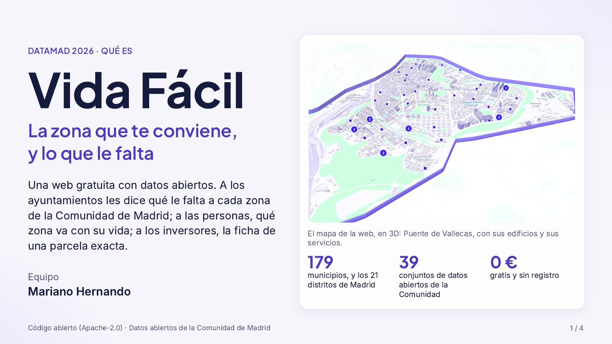

# 7 · Vida Fácil

**La zona que te conviene, y lo que le falta.**

**Equipo:** Mariano Hernando

## ¿Tenéis 5 minutos? Empezad por aquí

1. **Vídeo (1 minuto):** [VidaFacil_DATAMAD2026_video.mp4](VidaFacil_DATAMAD2026_video.mp4). La web de verdad, con su mapa 3D, y las cifras clave.
2. **Presentación (4 slides):** [VidaFacil_DATAMAD2026.pdf](VidaFacil_DATAMAD2026.pdf).
3. **La web, gratis y sin registro:** https://vidafacil-madrid.vercel.app

Todo explicado a fondo, con la fuente de cada cifra: [VidaFacil_DATAMAD2026_Dossier.pdf](VidaFacil_DATAMAD2026_Dossier.pdf) (14 páginas).

## Archivos de esta carpeta

| Archivo | Qué es |
|---|---|
| [VidaFacil_DATAMAD2026_video.mp4](VidaFacil_DATAMAD2026_video.mp4) | Vídeo de 62 s, sin sonido |
| [VidaFacil_DATAMAD2026.pdf](VidaFacil_DATAMAD2026.pdf) | Presentación (4 slides) |
| [VidaFacil_DATAMAD2026_Dossier.pdf](VidaFacil_DATAMAD2026_Dossier.pdf) | Dossier para el jurado (14 páginas) |
| [portada.jpg](portada.jpg) | La primera slide, como portada de esta página |
| [VidaFacil_codigo.zip](VidaFacil_codigo.zip) | El código en la versión de la entrega, el tag `datamad-2026-entrega` (23 nov 2026), sin la carpeta `evidence/` (320 MB de capturas y pruebas) |

El repositorio completo, con su historial y las evidencias: https://github.com/marianohernando/housing-intelligence/tree/datamad-2026-entrega

## Qué es

Una web gratuita y una API abierta que cruzan **39 conjuntos del Portal de Datos Abiertos de la Comunidad de Madrid** para decir qué le falta a cada zona de la región, a cuánta gente afecta y con qué datos. Cubre los 179 municipios y los 21 distritos de Madrid. Tres usos de los mismos datos:

- **Ayuntamientos:** qué le falta a cada zona. Por ejemplo, 25.551 niños de 0 a 4 años viven en 3 zonas donde faltan escuelas infantiles; la primera, Puente de Vallecas.
- **Personas:** la zona que te conviene. A una familia con 2 hijos, 1.500 € al mes y trabajo en la Castellana le convienen 42 de 199 zonas.
- **Inversores:** la ficha de una parcela exacta de Madrid capital, en 9 partes y con fuentes. Por ejemplo, 13.121 m² edificables en Méndez Álvaro 47.

## Por qué

Los datos existen, pero están sueltos: el precio en una web, los colegios en otra, el transporte en otra, y nadie dice qué le falta a cada zona. Otros enseñan lo que hay; Vida Fácil, lo que falta.

## Qué mide y cómo elige tu zona

- **Qué mide:** lo que tienes a 15 minutos andando, por cada 1.000 personas que lo comparten (escuelas infantiles, colegios, centros de salud, mayores y farmacias), comparado sin IA con municipios parecidos. Cada zona sale FALTA, JUSTO, CUBIERTO o SIN DATOS, con su fuente y su probabilidad. Comprobado: en Parla, 2,03 farmacias por 10.000 habitantes; la estadística oficial da 2,04.
- **Cómo elige tu zona:** nos cuentas tu hogar, tu presupuesto, dónde trabajas y qué te importa; lo imprescindible filtra (cumple, no cumple o «no lo sabemos», que nunca cuenta como cumple); lo que te importa puntúa, y lo primero pesa más; y te decimos por qué, con hechos que puedes comprobar.

## Cómo se financia

Gratis siempre para personas, ayuntamientos e inversores: los datos, las zonas, «Qué falta», cada ficha de parcela, la API y el MCP. Pagarán las empresas que trabajan con suelo a escala, con el plan empresarial: carteras de parcelas, avisos de suelo nuevo, gran volumen con clave e informes a medida. Hoy cuesta 0 € al mes; para poder cobrar, unos 45 $ al mes.

## API y MCP, abiertos y sin clave

- **API:** 15 rutas de datos, con OpenAPI: https://vidafacil-madrid.vercel.app/api/v1/openapi.json
- **MCP:** una capa fina sobre la API, con 7 herramientas de solo lectura: `https://vidafacil-madrid.vercel.app/api/v1/mcp`
- **Catálogo DCAT-AP** (62 conjuntos): https://vidafacil-madrid.vercel.app/datos/catalogo.dcat.jsonld
- **Smart Data Models** (39 conjuntos y 2.957 farmacias): https://vidafacil-madrid.vercel.app/datos/sdm/datasets.json
- **Código abierto (Apache-2.0):** https://github.com/marianohernando/housing-intelligence (versión de la entrega: tag `datamad-2026-entrega`, también en `VidaFacil_codigo.zip`)

## Conjuntos de datos de la Comunidad de Madrid (39)

Los 39 superan nuestro control de calidad. La lista con la licencia, el uso y la nota MELODA de cada uno está en el [repositorio](https://github.com/marianohernando/housing-intelligence/blob/claude/sprint-1-public/pitch/datasets_cm.md).

1. [Alquiler del metro cuadrado medio mensual de viviendas habituales arrendadas por código postal para el municipio de Madrid](https://datos.comunidad.madrid/dataset/1934259) · Instituto de Estadística
2. [Alquiler del metro cuadrado mensual de viviendas arrendadas con valor catastral para municipios de más de 20.000 habitantes por tipo de vivienda. Municipios](https://datos.comunidad.madrid/dataset/alquiler_metro_cuadrado_mensual_viviendas_arrendadas_valor_catastral_municipios_mas_20000) · Instituto de Estadística
3. [Red de Calidad del Aire. Estaciones](https://datos.comunidad.madrid/dataset/calidad_aire_estaciones) · Comunidad de Madrid
4. [Red de Calidad del Aire. Datos horarios desde 2005](https://datos.comunidad.madrid/dataset/calidad_aire_datos_historico) · Comunidad de Madrid
5. [Red de Calidad del Aire. Municipios por zonas](https://datos.comunidad.madrid/dataset/calidad_aire_zonas) · Comunidad de Madrid
6. [Catastro Inmobiliario. Inmuebles por distrito y uso](https://datos.comunidad.madrid/dataset/catastro_inmuebles_por_distrito_y_uso) · Instituto de Estadística de la Comunidad de Madrid
7. [Catastro Inmobiliario. Unidades urbanas por uso. Municipios](https://datos.comunidad.madrid/dataset/unidades_urbanas_por_uso) · Instituto de Estadística de la Comunidad de Madrid
8. [Registro de centros de atención social](https://datos.comunidad.madrid/dataset/atencion_social_registro_centros) · Comunidad de Madrid
9. [Centros educativos de la comunidad de Madrid](https://datos.comunidad.madrid/dataset/centros_educativos) · Comunidad de Madrid
10. [Centros, servicios y establecimientos sanitarios](https://datos.comunidad.madrid/dataset/centros_servicios_establecimientos_sanitarios) · Comunidad de Madrid
11. [Dotación de camas por dependencia](https://datos.comunidad.madrid/dataset/1912720) · Instituto de Estadística
12. [Recursos sanitarios. Farmacias. Municipios](https://datos.comunidad.madrid/dataset/farmacias) · Instituto de Estadística
13. [Hogares por tamaño del hogar. Censo 2021. Municipios](https://datos.comunidad.madrid/dataset/censo_2021_hogares_por_tamanyo) · Instituto de Estadística
14. [Hospitales y datos asistenciales](https://datos.comunidad.madrid/dataset/1912744) · Instituto de Estadística
15. [Hechos conocidos de infracciones penales por tipología en municipios mayores de 20.000 habitantes por municipio](https://datos.comunidad.madrid/dataset/hechos_conocidos_penales_por_tipologia_municipios_mayores_20000_por_municipio) · Instituto de Estadística
16. [Nacidos vivos por lugar de residencia de la madre y sexo. Municipios](https://datos.comunidad.madrid/dataset/mnp_nacidos_vivos_por_residencia_y_sexo) · Instituto de Estadística
17. [Oficinas de farmacia](https://datos.comunidad.madrid/dataset/oficinas_farmacia) · Comunidad de Madrid
18. [Parcelas publicadas en el Portal del Suelo 4.0](https://datos.comunidad.madrid/dataset/parcelas_portal_suelo) · Comunidad de Madrid
19. [Población censada por edad, nacionalidad y sexo. Censo anual. Municipios](https://datos.comunidad.madrid/dataset/poblacion_censada_por_edad_nacionalidad_y_sexo) · Instituto de Estadística
20. [Indicador de Renta Disponible Bruta Municipal. Municipios](https://datos.comunidad.madrid/dataset/irpf_indicador_renta) · Instituto de Estadística
21. [Secciones censales](https://datos.comunidad.madrid/dataset/secciones_censales) · Comunidad de Madrid
22. [Transacciones inmobiliarias de vivienda nueva y de segunda mano, por municipio. Comunidad de Madrid](https://datos.comunidad.madrid/dataset/transacciones_vivienda_nueva_usada_municipio) · Instituto de Estadística
23. [Unidades escolares en centros no universitarios del régimen general por tipo de centro y enseñanza que imparten. Municipios](https://datos.comunidad.madrid/dataset/unidades_centros_no_universitarios_general_por_tipo_y_ensenanza) · Instituto de Estadística
24. [Valor tasado vivienda libre en municipios de más de 25.000 habitantes por antigüedad (euros/m2). Municipios](https://datos.comunidad.madrid/dataset/valor_tasado_por_antiguedad) · Instituto de Estadística
25. [Valor tasado de la vivienda libre por municipios de más de 25.000 habitantes. Total (Base 2005). Municipios](https://datos.comunidad.madrid/dataset/1004050) · Instituto de Estadística
26. [Visados, superficie y presupuesto de dirección de obra de edificios por tipo de obra y características de los edificios](https://datos.comunidad.madrid/dataset/1006022) · Comunidad de Madrid
27. [Censo anual Comunidad de Madrid. Viviendas por año de antigüedad. Municipios](https://datos.comunidad.madrid/dataset/censo_anual_vivienda_por_antiguedad) · Instituto de Estadística
28. [Censo anual Comunidad de Madrid. Viviendas por superficie agregada. Municipios](https://datos.comunidad.madrid/dataset/censo_anual_vivienda_por_superficie_agregada) · Instituto de Estadística
29. [Censo de vivienda y locales 2021. Viviendas familiares principales por régimen de tenencia. Municipios](https://datos.comunidad.madrid/dataset/censo_2021_viviendas_familiares_por_tenencia) · Instituto de Estadística
30. [Aparcamientos de disuasión ligados al transporte público en la Comunidad de Madrid](https://datos.comunidad.madrid/dataset/aparcamientos_disuasion) · Consorcio Regional de Transportes de Madrid
31. [Oferta planificada de la Red de Autobuses Urbanos del resto de municipios de la Comunidad de Madrid](https://datos.comunidad.madrid/dataset/red_de_autobuses_urbanos_resto_municipios_horarios_topologia) · Consorcio Regional de Transportes de Madrid
32. [Oferta planificada de la Red de Cercanías Madrid](https://datos.comunidad.madrid/dataset/red_de_cercanias_oferta_planificada_horarios_topologia) · Consorcio Regional de Transportes de Madrid
33. [Oferta planificada de la Red de Autobuses Urbanos de Madrid - EMT](https://datos.comunidad.madrid/dataset/red_de_autobuses_urbanos_emt_horarios_topologia) · Consorcio Regional de Transportes de Madrid
34. [Oferta planificada de la Red de Autobuses Interurbanos](https://datos.comunidad.madrid/dataset/red_de_autobuses_interurbanos_horarios_topologia) · Consorcio Regional de Transportes de Madrid
35. [Oferta planificada de la Red de Metro](https://datos.comunidad.madrid/dataset/red_de_metro_oferta_planificada_horarios_topologia) · Consorcio Regional de Transportes de Madrid
36. [Oferta planificada de la Red de Metro Ligero](https://datos.comunidad.madrid/dataset/red_de_metro_ligero_oferta_planificada_horarios_topologia) · Consorcio Regional de Transportes de Madrid
37. [Topología de la Red de Cercanías Madrid](https://datos.comunidad.madrid/dataset/red_de_cercanias_lineas_estaciones_accesos_vestibulos_andenes) · Consorcio Regional de Transportes de Madrid
38. [Topología de la Red de Metro](https://datos.comunidad.madrid/dataset/red_de_metro_lineas_estaciones_accesos_vestibulos_andenes) · Consorcio Regional de Transportes de Madrid
39. [Topología de la Red de Metro Ligero / Tranvía](https://datos.comunidad.madrid/dataset/red_de_metro_ligero_tranvia_lineas_estaciones_accesos_vestibulos_andenes) · Consorcio Regional de Transportes de Madrid

Como apoyo, sin contarlos como datos de la Comunidad: el Ayuntamiento de Madrid, OpenStreetMap, el Ministerio de Sanidad, la Agencia Tributaria y el Ministerio de Vivienda (59 conjuntos en total).

## Trabajo previo y uso de IA

El trabajo anterior al concurso está marcado con el tag `pre-datamad` (22 oct 2026): la geografía, los 10 primeros conjuntos y un mapa base; todo lo demás se hizo durante el concurso. Usamos asistentes de IA para programar, como permiten las bases; ninguna cifra la genera una IA.
